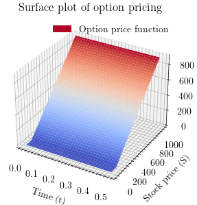
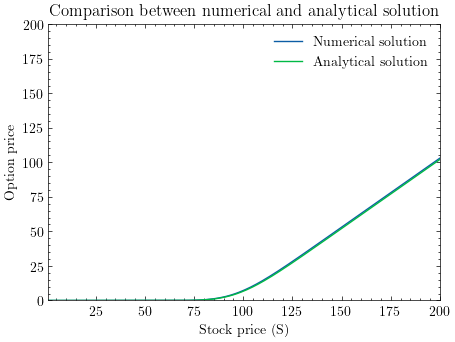
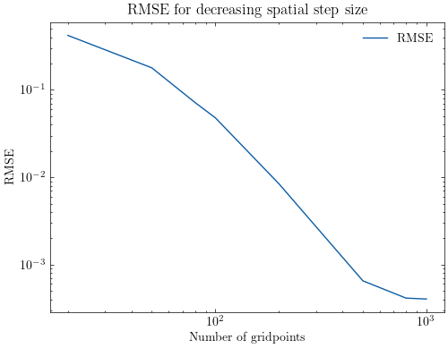
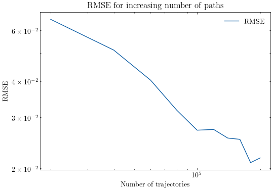

# Asymmetric interst rates - Pricing an European call option.

> Numerical implementations of the Black-Scholes model using both a finite difference (PDE) solver and a Forward-Backward Stochastic Differential Equation (FBSDE) solver.

---

## Overview

This project studies the application of asymmetric interest rates on the pricing of an European call option. The differing interest rates represents the realistic setting where an investor generally pays a higher interest rate when borrowing than what the investor recieves as a lender. This is applied to the Black-Scholes model. We price the European call option using numerical methods based on a Partial Differential Equation framework and a Forward Backwards Stochastic Differential Equation framework. We conclude that the interest rate for lending money has no impact on the solution since we are in fact never lending money to finance the replicating trading strategy.

>The project originated as part of a university course in computational finance and has since been refactored into a reusable Python package with improved software architecture, documentation, validation, and examples.

---

## Features

- Finite Difference (PDE) solver. Including Crank Nicolson, Explicit- and Implicit Euler. 
- FBSDE solver.
- Configurable model parameters.
- Input validation.
- Example script.

---

## Repository Structure

```text
docs/
figures/
src/
    blackScholesSolver/
        config/
        errors/
        fbsde/
        pde/
    examples/
```

- `docs/` - Contains the report associated with the project.
- `figures/` - Contains the Figures used throughout the Result section of this README.md.
- `src/blackScholesSolver/` - Contains the source code of the project.  
- `examples/` - Contains the example files for the implementation.

---

## Installation

Download and install by:

```bash
git clone https://github.com/linema31/asymmetric_interest_rates.git
cd asymmetric_interest_rates
pip install -r requirements.txt
```

Run a simple example:

```bash
cd src/
python3 -m examples/example
```
## Quick Start

```python
from blackScholesSolver import modelConfig, pdeConfig, fbsdeConfig, PDEsolver, FBSDEsolver

mod_config = modelConfig()

pde_config = pdeConfig()

fbsde_config = fbsdeConfig()

u0, t, s, u = PDEsolver(mod_config, pde_config)

Y0, Yt, Zt = FBSDEsolver(mod_config, fbsde_config)

print(f"Price using pde: {u0:.4f}\n")
print(f"Price using fbsde: {Y0:.4f}\n")

```

---

## Mathematical Background
In this section we describe the problem this implementation is solving and the methods for the implementation. For specific details regarding the problem and solution see `docs/lender_borrower_interest_rates.pdf`.

### Problem
This project studies the pricing of a European call option in a modified Black–Scholes framework with asymmetric borrowing and lending interest rates. Unlike the classical model, the interest rate depends on the cash position of the replicating portfolio, introducing a nonlinear term into the pricing equation.

The option price is governed by the nonlinear Black–Scholes PDE

$$
\frac{\partial u}{\partial t} + \frac{1}{2} \sigma^2 S^2 \frac{ \partial^2 u}{\partial S^2} = 
\rho \left(u-S\frac{\partial u}{\partial S}\right)
\left(u-S\frac{\partial u}{\partial S}\right),
$$

where

$$
\rho(x)=
\begin{cases}
r, & x\ge0,\\
R, & x<0,
\end{cases}
\qquad R\ge r.
$$

To solve this nonlinear pricing problem, two independent numerical approaches are implemented: a deterministic PDE solver and a probabilistic FBSDE solver.

### PDE solution
The deterministic formulation is solved using a Crank–Nicolson finite difference scheme on a uniform space-time grid. Since the active interest rate depends on the cash position, the nonlinear term is updated iteratively throughout the backward time-stepping procedure. The option price at the initial stock value is recovered using second-order Taylor interpolation.

### FBSDE solution
The probabilistic formulation is solved using a Forward–Backward Stochastic Differential Equation (FBSDE) framework. Stock price trajectories are simulated exactly under geometric Brownian motion, after which the BSDE is solved backwards in time. Conditional expectations are approximated using least-squares polynomial regression, producing a Monte Carlo estimate of the option price.


## Results
In this section we briefly describe the result found in the report. This includes insights as well as validation. 

Both numerical methods converge to the same solution and agree with the analytical Black–Scholes price obtained by using the borrowing rate only. Convergence studies confirm that the numerical error decreases with increasing spatial resolution for the PDE method and with increasing sample size for the FBSDE method.

Below we can see a surface plot generated by the implementation. From this we can read the solution price given any initial stock price.

<div style="text-align: center;>



</div>

Below is a line plot comparing th numerical PDE solution to the analytical solution for the Black-Scholes PDE.

<div style="text-align: center;>



</div>

To notice is that the numerical price coincide with the analytical price, even though the analytical price does not take the differing interest rates into account. 

We investigate how the analytical solution differs from the numerical solution using Root mean square error (RMSE) which can be seen in the line plot below.

<div style="text-align: center;>



</div>

From the plot above one can see that the solution does converge to the analytical solution as the number of grid points increases.

A similar convergence test is done for the probabilistic framework using monte carlo estimates. Where we increased the number of trajectories. This can be seen in the line plot below.
<div style="text-align: center;>



</div>
From the convergence study above we see that the FBSDE solution does indeed also converge to the analytical solution for the Black-Scholes PDE. Using these convergence results we validated both numerical models for the pricing problem.

The main conclusion is that, for this pricing problem, the lending rate has no influence on the option value because the replicating strategy never enters a lending position. Consequently, the nonlinear model produces the same price as the classical Black–Scholes model using the borrowing interest rate.

---

## Educational Context

>This repository originated from a university laboratory project in computational finance. The codebase has since been substantially refactored with improved software architecture, documentation and validation. The repository is maintained independently and is not affiliated with or endorsed by the university.

---


## Author

Linus Emanuel
